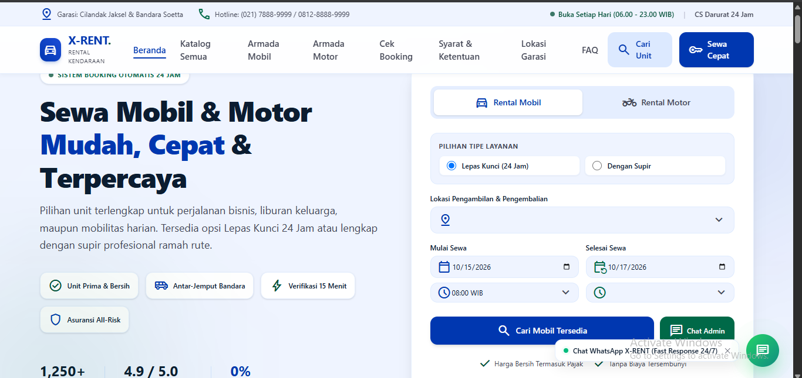
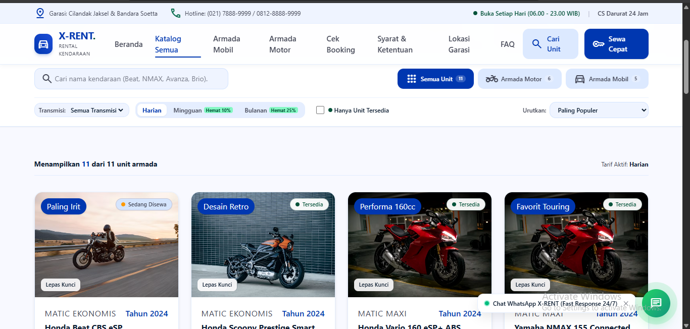
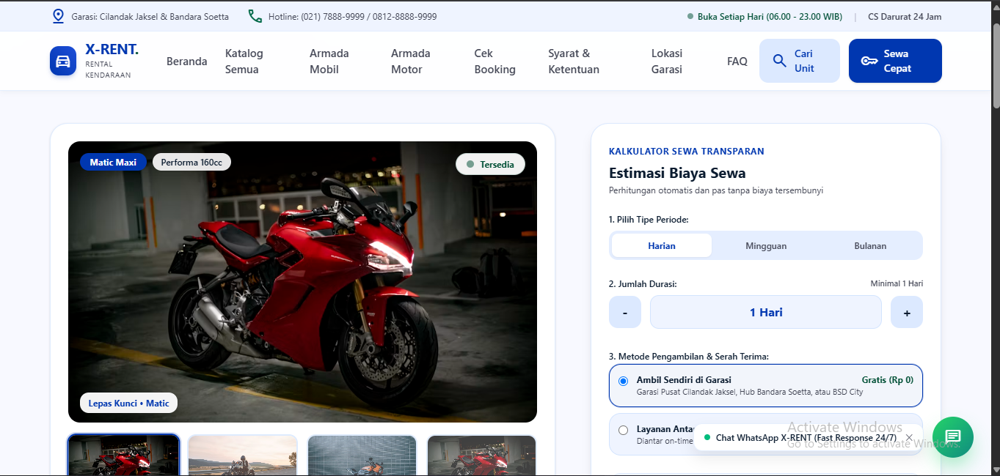
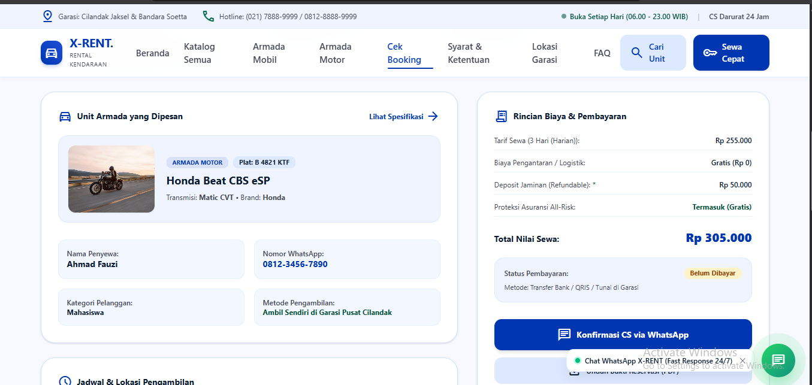
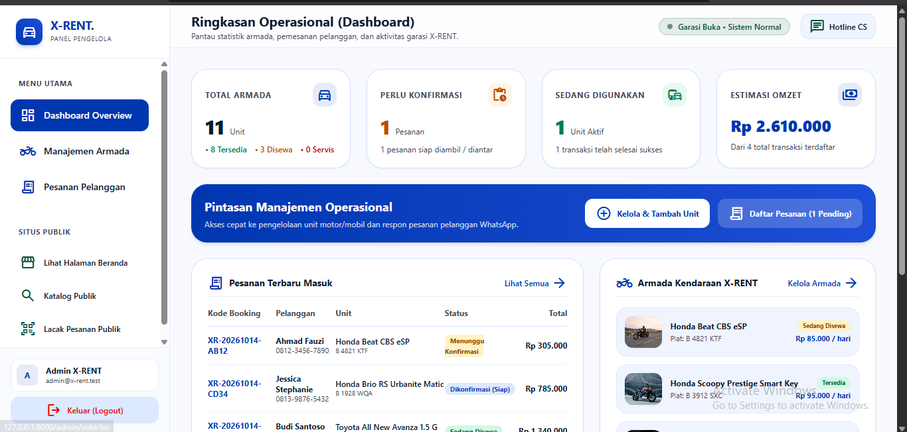

# 🏍️ X-RENT — Platform Penyewaan Sepeda Motor Digital

[](https://laravel.com)
[](https://vuejs.org)
[](https://inertiajs.com)
[](https://tailwindcss.com)

**X-RENT** adalah platform web penyewaan sepeda motor berbasis digital (harian, mingguan, bulanan) yang dirancang untuk mendukung kegiatan promosi, pemesanan online, komunikasi pelanggan, dan manajemen pengelola secara transparan dan cepat.

---

## ✨ Fitur Utama

1. **Katalog Unit & Ketersediaan Real-time:** Menampilkan spesifikasi motor (CC, Transmisi, Helm), kondisi umum, serta badge status (`Tersedia`, `Sedang Disewa`, `Servis`).
2. **Multi-Tarif & Kalkulator Harga Otomatis:** Perhitungan tarif Harian, Mingguan, dan Bulanan yang diperbarui secara reaktif menggunakan Vue 3, lengkap dengan opsi tambahan *Antar-Jemput*.
3. **Pemesanan Online & Integrasi WhatsApp:** Formulir pemesanan yang otomatis menghasilkan Kode Booking unik (`XR-YYYYMMDD-XXXX`) dan mengarahkan konfirmasi ke WhatsApp Admin.
4. **Pelacakan Status Pesanan (Track Order):** Memungkinkan pelanggan melacak status sewa (*Menunggu Konfirmasi → Diterima → Sedang Disewa → Selesai*) tanpa perlu membuat akun/login.
5. **Panel Admin Terintegrasi:** Dashboard khusus pengelola untuk mengelola inventaris motor (CRUD) dan memverifikasi pesanan masuk.

---

## 📸 Tampilan Aplikasi

### Beranda


### Katalog Unit


### Detail Unit & Form Pemesanan


### Cek Status Booking (Track Order)


### Panel Admin


---

## 🛠️ Tech Stack

| Bagian | Teknologi |
| --- | --- |
| Backend | Laravel 13.x (PHP 8.3+) |
| Frontend Bridge | Inertia.js (`inertiajs/inertia-laravel` & `@inertiajs/vue3`) |
| UI Framework | Vue 3 (`<script setup>`) + Vite + Tailwind CSS v4 |
| Icons | `lucide-vue-next` |
| Database | MySQL (Laragon / XAMPP) |

---

## 🚀 Panduan Kolaborasi & Setup untuk Teman Tim

Ikuti langkah-langkah ini di komputer lokal untuk menjalankan proyek X-RENT.

### 1. Prasyarat Sistem

Pastikan komputer sudah menginstal:

- **PHP** versi 8.3 atau 8.4 (direkomendasikan menggunakan **Laragon**)
- **Composer** (dependency manager PHP)
- **Node.js & npm** (runtime JavaScript untuk frontend)
- **Git**

### 2. Kloning Repositori

Buka terminal/command prompt, lalu jalankan:

```bash
git clone https://github.com/iwp10/x-rent.git
cd x-rent
```

### 3. Instalasi Dependensi

```bash
# Install dependensi PHP
composer install

# Install dependensi Node.js
npm install
```

### 4. Konfigurasi Environment (`.env`)

Salin file konfigurasi contoh:

```bash
cp .env.example .env
```

Buka file `.env` yang baru dibuat, lalu sesuaikan koneksi database MySQL:

```env
DB_CONNECTION=mysql
DB_HOST=127.0.0.1
DB_PORT=3306
DB_DATABASE=db_xrent
DB_USERNAME=root
DB_PASSWORD=
```

### 5. Generate Key & Migrasi Database

Buat database kosong bernama `db_xrent` di MySQL (melalui HeidiSQL/phpMyAdmin), lalu jalankan:

```bash
php artisan key:generate
php artisan migrate:fresh --seed
```

Perintah di atas juga otomatis membuat akun admin default:

- **Email:** `admin@x-rent.test`
- **Password:** `password`

### 6. Menjalankan Server Development

Buka dua terminal terpisah di dalam folder proyek.

**Terminal 1** (Laravel server):

```bash
php artisan serve
```

**Terminal 2** (Vite asset bundler):

```bash
npm run dev
```

Buka browser dan akses <http://127.0.0.1:8000>. Untuk masuk ke Panel Admin, akses <http://127.0.0.1:8000/admin/login>.

---

## 📁 Struktur Direktori Utama

| Path | Keterangan |
| --- | --- |
| `app/Http/Controllers/` | Controller Laravel (`HomeController`, `VehicleController`, `AdminAuthController`, dll.) |
| `database/migrations/` | Skema tabel database (kategori, kendaraan, pesanan) |
| `database/seeders/` | Data awal untuk unit motor dan akun admin |
| `resources/js/Pages/` | Halaman Inertia.js berbasis Vue 3 (`Home.vue`, `Catalog.vue`, `VehicleDetail.vue`, `TrackBooking.vue`, serta folder `Admin/`) |
| `resources/js/Layouts/` | Layout utama (`MainLayout.vue` & `AdminLayout.vue`) |
| `routes/web.php` | Daftar seluruh rute aplikasi web |

---

## 🧪 Pengujian Sistem (Testing)

Lakukan skenario berikut untuk memastikan seluruh fitur berjalan dengan baik.

### Sisi Pelanggan (Guest Flow)

1. Buka <http://127.0.0.1:8000>, jelajahi katalog motor dan gunakan filter reaktif (berdasarkan kategori atau pencarian nama).
2. Klik salah satu motor untuk melihat halaman detail, lalu ubah opsi durasi (Harian/Mingguan/Bulanan) untuk melihat kalkulator harga menghitung total biaya secara otomatis.
3. Isi formulir pemesanan online dan klik tombol pesan untuk menguji redirect ke WhatsApp Admin serta penyimpanan data ke database.
4. Salin kode booking yang didapat, lalu buka menu **Cek Booking** di Navbar untuk melacak status pesanan melalui Progress Stepper.

### Sisi Pengelola (Admin Flow)

1. Akses <http://127.0.0.1:8000/admin/login>.
2. Masuk dengan kredensial default:
   - **Email:** `admin@x-rent.test`
   - **Password:** `password`
3. Di dasbor admin, uji fitur tambah unit motor baru (CRUD) dan ubah status pesanan masuk dari pelanggan.

---

## 👥 Kontributor

- Muhammad Dwi Ramadhan ([@iwp10](https://github.com/iwp10))
- *(Tambahkan nama teman kolaborasimu di sini)*
